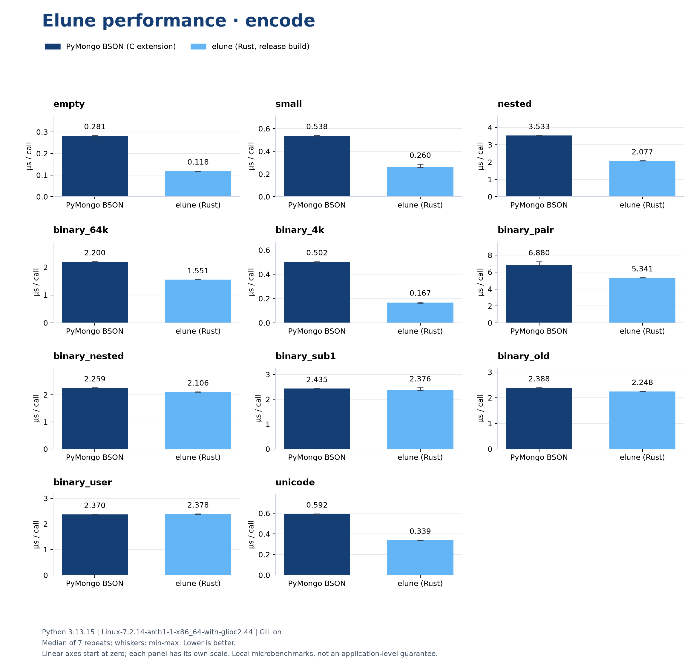
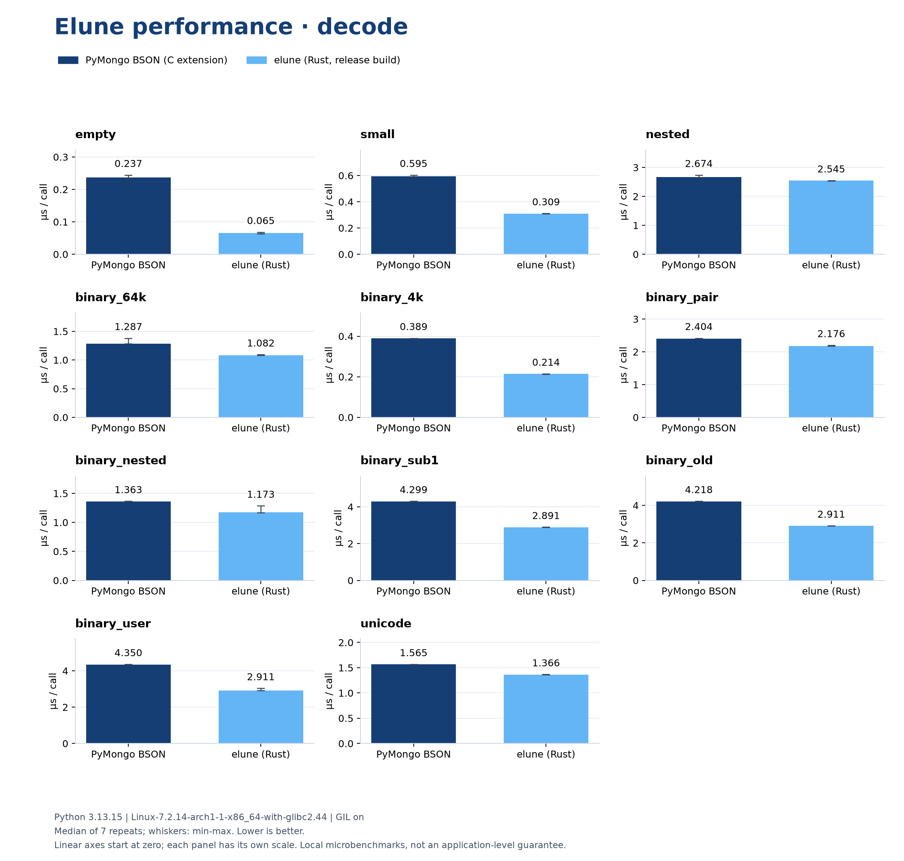
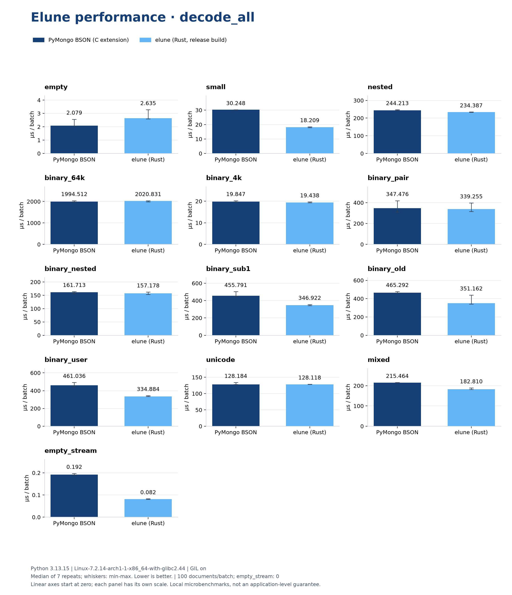

# Elune benchmark charts

Dark blue: PyMongo BSON with its native C extension, independently installed
as `_p_bson`. Light blue: Elune's Rust BSON codec, release build.





Each pair shows median microseconds per call; lower is better. Whiskers show
the minimum and maximum of seven repeats. Each panel uses its own linear
axis starting at zero. `decode_all` measures batches of 100 documents, except
`empty_stream`, which contains no documents. All cases are shown, including
those where PyMongo is faster. These are local, single-threaded microbenchmarks,
not universal application-level performance claims.

The measurement command saves raw samples and runtime metadata to
`results.json`. Inputs and correctness checks reuse the benchmark helpers;
both implementations are warmed up and timing order alternates.

From the repository root, after preparing `_p_bson` using the existing setup
script and building this extension with `maturin develop --release`:

```sh
python -m benchmarks.charts measure
python -m pip install matplotlib
python -m benchmarks.charts render
```

Measurement does not require matplotlib. Rendering only reads JSON and can run
under a different interpreter. The committed charts were regenerated on
Linux x86_64 with Python 3.13.15 and the GIL enabled.
